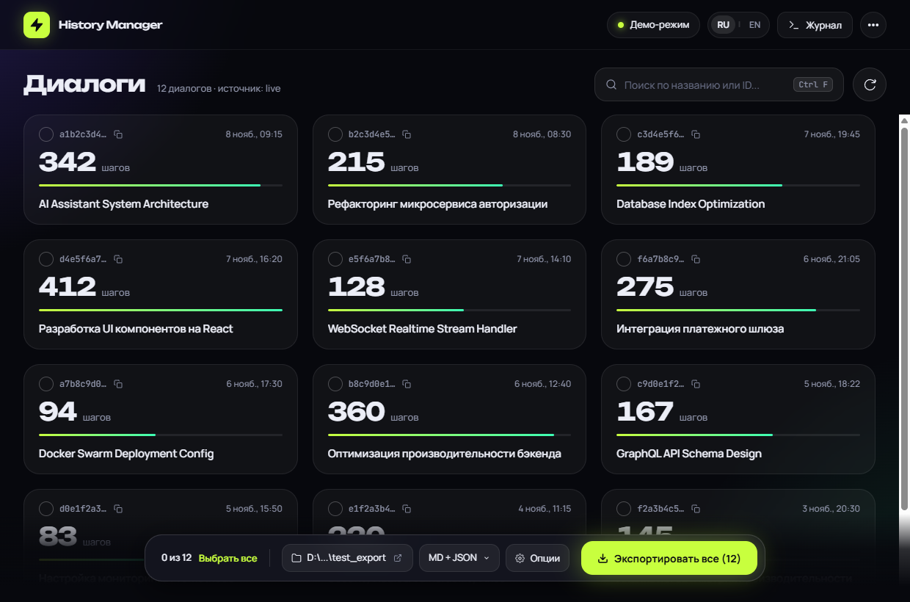
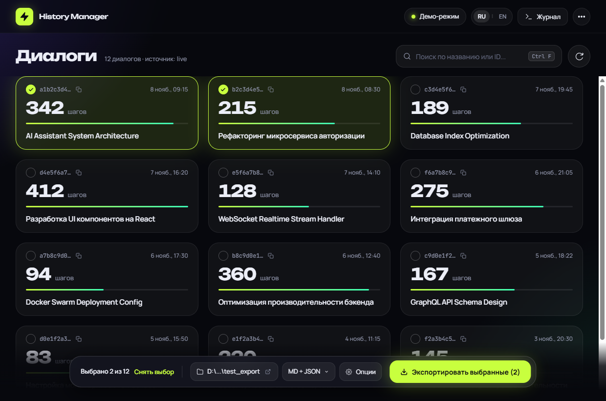
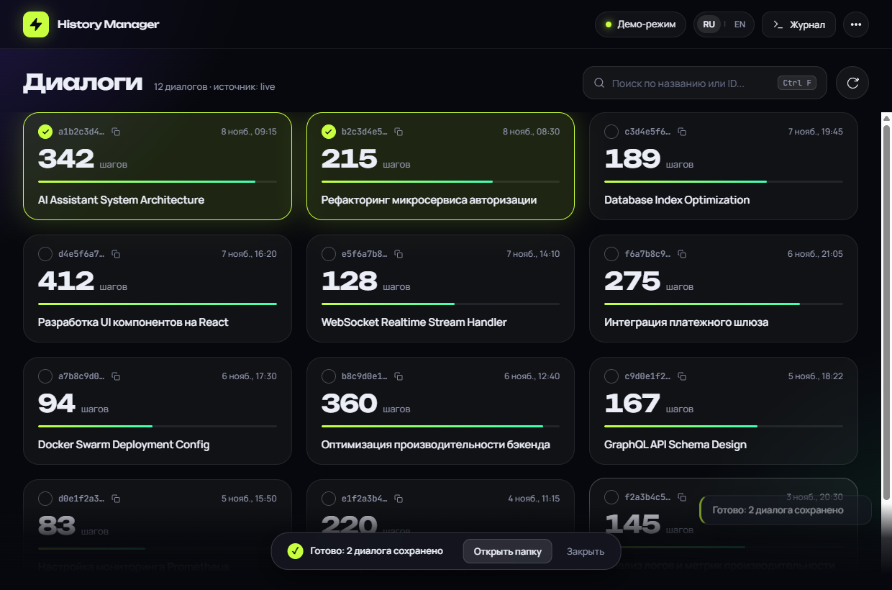
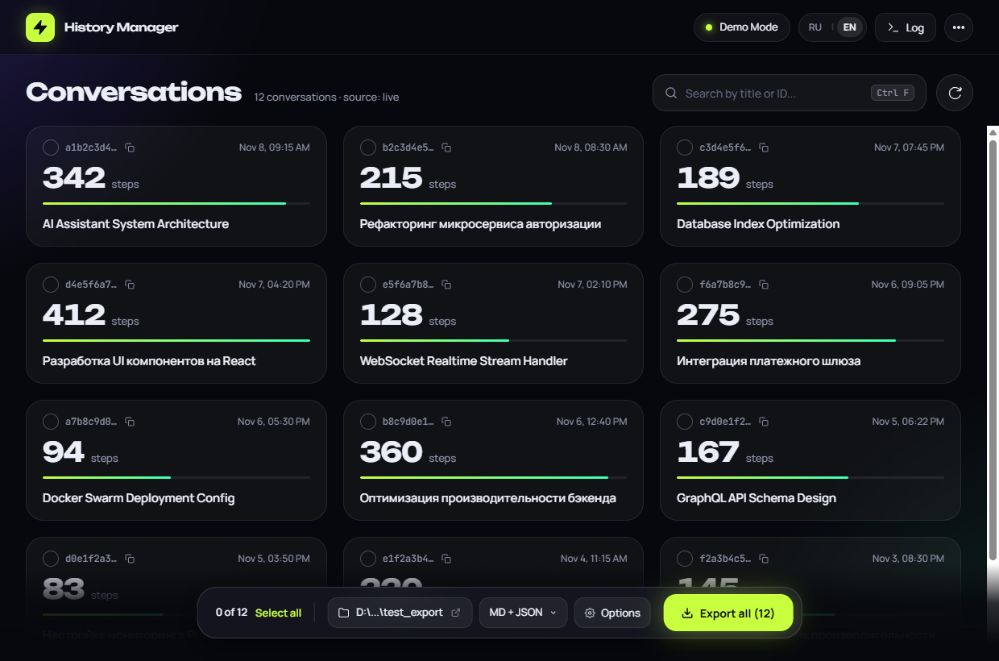

# Antigravity History Manager ⚡

<p align="center">
  
</p>

<p align="center">
  <strong>Современный графический интерфейс для выгрузки, резервного копирования и восстановления истории диалогов Google Antigravity.</strong><br>
  <em>A modern, high-performance GUI to export, back up, and inspect your Google Antigravity conversations.</em>
</p>

<p align="center">
  <a href="#russian">Русский</a> • <a href="#english">English</a>
</p>

---

<a name="russian"></a>
## 🇷🇺 Русский

### О программе
**Antigravity History Manager** — это легковесное десктопное приложение на базе **Tauri v2** (бэкенд на Rust, интерфейс на HTML/CSS/JS с аппаратным ускорением WebView2), созданное в эстетике «neo-dark / neon-glass». 

Программа позволяет в пару кликов выгружать ваши диалоги с искусственным интеллектом в удобные форматы (Markdown, JSON), просматривать локальные базы данных SQLite и отслеживать сессии в реальном времени.

### Основные возможности
- 🗂 **Интерактивная сетка диалогов:** Карточки с крупными счетчиками шагов, градиентной полосой объема, быстрым копированием UUID и локализованными датами.
- ⚡ **Вшитый движок выгрузки:** Модифицированный `aghistory` включён в поставку (sidecar); **Python и pip пользователю не требуются**.
- 🔍 **Умный поиск и фильтрация:** Мгновенный поиск по названию или ID диалога с подсветкой совпадений (`Ctrl + F`).
- 🔘 **Плавающая панель управления:** Удобный выбор нужных чатов (клик, Shift+клик для диапазона, Ctrl+A), выбор папки и формата в один клик.
- 🌐 **Два режима работы:**
  - **Live-режим:** Подключается к запущенному Google Antigravity, динамически определяет порт и CSRF-токен и выгружает актуальные сессии.
  - **Режим базы данных (.db):** Позволяет просматривать и восстанавливать диалоги из локальных файлов базы данных SQLite, даже если сам Antigravity закрыт.
- 🇷🇺 / 🇬🇧 **Мгновенное переключение языка (RU / EN):** Полная динамическая локализация всех надписей и дат.
- 🪵 **Встроенный журнал работы:** Выдвижная консоль логов с мониторингом процессов и индикацией ошибок.

### Скриншоты

<p align="center">
  
</p>

<p align="center">
  
</p>

<p align="center">
  
</p>

### Системные требования
- **ОС:** Windows 10 (билд 1809+) или Windows 11 (64-бит).
- **WebView2 Runtime:** предустановлен в Windows 10/11. Если компонент отсутствует, установщик скачает его автоматически, либо приложение предложит прямую ссылку.
- **Для Live-режима:** запущенный редактор Google Antigravity.

### Установка и быстрый старт
1. Перейдите на страницу **[Releases](https://github.com/your-username/antigravity-history-manager/releases)**.
2. Скачайте нужную версию:
   - **Портативная версия:** `Antigravity_History_Manager.exe` (не требует установки, можно запускать из любой папки).
   - **Установщик:** `Antigravity_History_Manager_Setup.exe` (устанавливает ярлыки в меню Пуск и автоматически проверяет WebView2).
3. Запустите файл.

> [!TIP]
> **Предупреждение Windows SmartScreen:**  
> Так как приложение распространяется как независимый open-source проект без покупки дорогостоящего коммерческого цифрового сертификата, при первом запуске Windows может показать синее окно: **«Защитник Windows защитил ваш компьютер»** (SmartScreen).  
> **Что делать:** Нажмите ссылку **«Подробнее»** (More info) $\to$ кнопку **«Выполнить в любом случае»** (Run anyway). Это стандартное поведение для новых программ без платной цифровой подписи.

### Решение проблем
- **Не найден запущенный Antigravity:** Убедитесь, что редактор Google Antigravity открыт. Если Antigravity закрыт или сессия завершена, переключитесь в «Режим базы данных (.db)» через меню «Опции» для чтения сохранённой локальной истории.
- **Белое окно или ошибка WebView2:** Убедитесь, что в системе установлен Microsoft Edge WebView2 Runtime. При использовании установщика компонент загружается автоматически. Для ручной установки скачайте [WebView2 Bootstrapper](https://developer.microsoft.com/en-us/microsoft-edge/webview2/) от Microsoft.
- **Предупреждение антивируса / SmartScreen:** Нажмите «Подробнее» $\to$ «Выполнить в любом случае». См. раздел о SmartScreen выше.
- **Диагностика и логи:** Для просмотра подробных сообщений процесса нажмите кнопку `>_ Журнал` в правом верхнем углу интерфейса.

### Известные ограничения
- Утилита `aghistory` использует локальный API языкового сервера Google Antigravity (`GetAllCascadeTrajectories`). Поскольку этот API является внутренним и недокументированным, при выходе крупных обновлений редактора Google Antigravity формат или сетевые интерфейсы могут измениться. Приложение непрерывно обновляется для совместимости.

### Сборка из исходников
Если вы хотите собрать приложение самостоятельно:
```bash
# 1. Клонируйте репозиторий
git clone https://github.com/your-username/antigravity-history-manager.git
cd antigravity-history-manager

# 2. Установите зависимости
npm install

# 3. Запуск в режиме разработки
npm run tauri dev

# 4. Сборка релизного бинарника и установщика
npm run tauri build
```

---

<a name="english"></a>
## 🇬🇧 English

### Overview
**Antigravity History Manager** is a lightweight, high-performance desktop application powered by **Tauri v2** (Rust backend with hardware-accelerated WebView2 frontend) designed with a neo-dark glassmorphic visual aesthetic.

It allows you to export your conversations with AI models into clean Markdown and JSON, inspect local SQLite database history, and restore lost dialogues in a few clicks.

### Key Features
- 🗂 **Interactive Conversation Cards:** Responsive grid with prominent tabular step counts (`Unbounded` font), non-linear volume gradient bar, quick UUID copy, and localized timestamps.
- ⚡ **Bundled Export Engine:** Powered by a modified `aghistory` sidecar; **no Python or pip installation required**.
- 🔍 **Fast Search & Filter:** Instant search by title or conversation UUID with query highlighting (`Ctrl + F`).
- 🔘 **Floating Action Pill:** Bottom glassmorphic bar for batch selection, custom folder picking, format toggling, and progress tracking with interruption support.
- 🌐 **Two Operational Modes:**
  - **Live Mode:** Connects to active Google Antigravity processes, discovers dynamic ports and CSRF tokens automatically.
  - **Offline Database (.db) Mode:** Reads local SQLite files from `.gemini/antigravity` even when the editor is closed.
- 🇷🇺 / 🇬🇧 **Dynamic i18n (RU / EN):** One-click language switching on the fly without restarting.
- 🪵 **Built-in Developer Log Drawer:** Real-time stdout/stderr log output with unread error badges.

### Screenshots

<p align="center">
  
</p>

### System Requirements
- **OS:** Windows 10 (1809+) or Windows 11 (64-bit).
- **Microsoft Edge WebView2 Runtime:** Pre-installed on modern Windows. The installer includes an automatic bootstrapper if missing.
- **For Live Mode:** Google Antigravity editor actively running.

### Windows SmartScreen Note
Because this is an independent, free open-source project without a purchased enterprise code-signing certificate, Windows SmartScreen may display a warning on initial launch:
*Click **"More info"** $\to$ **"Run anyway"**.*

### Troubleshooting
- **Antigravity not detected in Live Mode:** Ensure the Google Antigravity editor is actively running with an open workspace. If Antigravity is closed, switch to "Database (.db) Mode" in the Options menu to inspect local SQLite history.
- **White screen or WebView2 runtime missing:** Ensure Microsoft Edge WebView2 Runtime is installed. The installer handles this automatically; for manual install, download the official Evergreen Bootstrapper from [Microsoft WebView2](https://developer.microsoft.com/en-us/microsoft-edge/webview2/).
- **SmartScreen / Security prompt:** Click "More info" $\to$ "Run anyway". See the SmartScreen note above.
- **Process Logs:** Click `>_ Log` in the upper-right corner of the window to inspect real-time IPC output and diagnostic errors.

### Known Limitations
`aghistory` interacts with Google Antigravity's local language server interface. As this protocol is internal and undocumented, future Antigravity updates may require adjustments to the discovery or API parser logic.

---

## License & Attribution

- **Antigravity History Manager** is distributed under the [MIT License](LICENSE).
- Bundled **antigravity-history** is distributed under the [Apache License 2.0](THIRD_PARTY_NOTICES.md) by Neo (https://github.com/neo1027144-creator/antigravity-history).
- Open-source typography: `Unbounded` (OFL), `Manrope` (OFL), `JetBrains Mono` (OFL).
